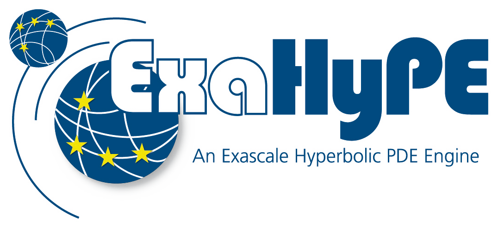

  <picture>
    <source media="(prefers-color-scheme: dark)" srcset="./documentation/logos/ExaHyPE-dark.png">
    
  </picture>

# Overview

ExaHyPE is an open-source simulation engine for high-performance, dynamically adaptive simulations
of hyperbolic partial differential equations (PDEs).

It solves systems of the form

$$
\frac{\partial Q}{\partial t} + \nabla \cdot F(Q, \nabla Q) + B(Q) \cdot \nabla Q = S(Q) + \sum_{i=1}^{n_{ps}} \delta_i
$$

Designed to bridge the gap between advanced numerical methods and large-scale scientific computing,
ExaHyPE provides a flexible and efficient basis for simulation applications across a wide range of
scientific disciplines.

At its core, ExaHyPE combines high-order numerical methods, including ADER discontinuous Galerkin
(ADER-DG), Runge-Kutta discontinuous Galerkin and finite-volume schemes with a-posteriori subcell
limiting, with dynamic adaptive mesh refinement and parallel computing. This enables accurate and
stable simulations of complex physical phenomena, from seismic wave propagation and tsunamis to
compressible flows and numerical relativity.

ExaHyPE separates application-specific physics from the numerical algorithms and the computational
infrastructure. Researchers describe their physical model in a short Python script, and ExaHyPE
generates optimised C++ code from it, with scalable parallel execution through MPI, OpenMP and GPU
backends.

Whether running on a workstation or on thousands of CPU cores and GPUs of a supercomputer, ExaHyPE
provides the computational foundation for tackling challenging scientific problems at scale. The
same application code runs on CPUs and on NVIDIA, AMD and Intel GPUs, through the native backends
CUDA, HIP and SYCL or through the performance-portable backends Kokkos, AdaptiveCpp and OpenMP
target offloading.

# Availability

The source code is open source at <https://github.com/ExaHyPE-Engine/ExaHyPE>.

# Installation (Dependencies and Prerequisites)

Get started with ExaHyPE following our [Installation Guide](documentation/installation.dox).

# Environments

We maintain packaged [environments](utilities)
for Docker, Apptainer, and [Spack](https://github.com/spack/spack/wiki) to simplify
setup on workstations and HPC systems.

# Contributing

Contributions are **welcome and very much appreciated**.
Please refer [to our Contribution Guide](CONTRIBUTING.md) for more details.

# Code of Conduct

We follow a [Code of Conduct](CODE_OF_CONDUCT.md).
Please follow the rules when participating in our community.

# License

Modified BSD License, see [LICENSE](LICENSE).

# Funding

ExaHyPE received funding from the European Union's Horizon 2020 research and innovation programme
under grant agreement No 671698 (ExaHyPE). Further development received funding from the ExCALIBUR
programme of the UK and from the European High Performance Computing Joint Undertaking (JU) under
grant agreement No 101093038 (ChEESE-2P).

  
  
  

